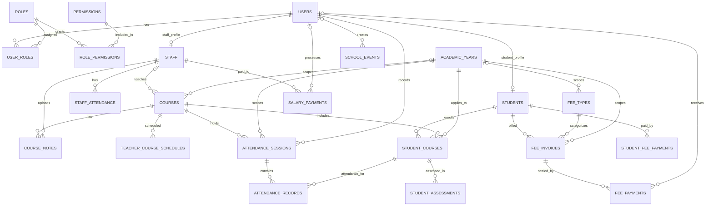

# School Management System Database Schema

## 1. Scope and conventions

This document describes the MySQL schema created by `database.sql`. The schema is
for the `school` database and uses `InnoDB` for tables with explicit engine
declarations. It contains 22 tables covering identity and access control,
students and staff, courses, attendance, fees, payroll, assessments, and events.

The initial `CREATE TABLE` definitions establish the canonical columns and
constraints; later statements in `database.sql` include compatibility DDL for
databases created by older versions of the script. Repeated definitions of a
table later in that file are not separate entities.

Notation used below:

- **PK** — primary key; uniquely identifies a row.
- **FK** — foreign key; references a row in another table.
- **UQ** — unique constraint or unique index.
- **NN** — `NOT NULL`.
- **NULL** — optional value.
- **AI** — auto-incrementing identifier.
- Unless stated otherwise, identifiers are `BIGINT UNSIGNED`.
- `DECIMAL(p, s)` is an exact numeric value with precision `p` and scale `s`.
- Enum values are listed exactly as allowed by the schema.

## 2. Entity relationship overview

The diagram shows the main foreign-key relationships. A crow's-foot (`{`)
indicates many rows; `o|` means zero or one; `||` means exactly one.

In the diagram, `STUDENT_COURSES` represents a specific student/course/academic
year enrollment, not just a student-course pair.

## 3. Entity and attribute reference

### 3.1 Access control and accounts

#### `users` — login and person account

| Attribute | Type | Constraints | Meaning |
|---|---|---|---|
| `id` | BIGINT UNSIGNED | PK, NN, AI | Account identifier. |
| `username` | VARCHAR(80) | NN, UQ | Login name. |
| `email` | VARCHAR(254) | NN | Email address; not declared unique. |
| `password_hash` | VARCHAR(255) | NN | Stored password hash, not a plaintext password. |
| `first_name` | VARCHAR(100) | NN | Given name. |
| `last_name` | VARCHAR(100) | NN | Family name. |
| `phone` | VARCHAR(30) | NULL | Contact phone number. |
| `profile_photo_path` | VARCHAR(255) | NULL | Stored profile-photo path. |
| `is_active` | BOOLEAN | NN, default TRUE | Whether the account is active. |
| `created_at` | TIMESTAMP | NN, default current timestamp | Account creation time. |

#### `roles` — named access roles

| Attribute | Type | Constraints | Meaning |
|---|---|---|---|
| `id` | BIGINT UNSIGNED | PK, NN, AI | Role identifier. |
| `code` | VARCHAR(40) | NN, UQ | Stable role key, such as `admin` or `teacher`. |
| `name` | VARCHAR(80) | NN | Display name. |

#### `permissions` — individual capabilities

| Attribute | Type | Constraints | Meaning |
|---|---|---|---|
| `id` | BIGINT UNSIGNED | PK, NN, AI | Permission identifier. |
| `code` | VARCHAR(80) | NN, UQ | Stable permission key, such as `courses.view`. |
| `description` | VARCHAR(255) | NN | Human-readable capability description. |

#### `user_roles` — user-to-role junction

| Attribute | Type | Constraints | Meaning |
|---|---|---|---|
| `user_id` | BIGINT UNSIGNED | PK part, FK to `users.id`, NN | User receiving the role. |
| `role_id` | BIGINT UNSIGNED | PK part, FK to `roles.id`, NN | Assigned role. |
| `assigned_at` | TIMESTAMP | NN, default current timestamp | Assignment time. |

The composite primary key prevents assigning the same role to the same user more
than once. Deleting a user cascades to its assignments; a role referenced here
cannot be deleted (`RESTRICT`).

#### `role_permissions` — role-to-permission junction

| Attribute | Type | Constraints | Meaning |
|---|---|---|---|
| `role_id` | BIGINT UNSIGNED | PK part, FK to `roles.id`, NN | Role receiving the permission. |
| `permission_id` | BIGINT UNSIGNED | PK part, FK to `permissions.id`, NN | Permission granted to the role. |

The composite primary key prevents duplicate grants. Deleting either the role or
permission cascades to this junction row.

### 3.2 Academic people and school structure

#### `students` — student profile

| Attribute | Type | Constraints | Meaning |
|---|---|---|---|
| `id` | BIGINT UNSIGNED | PK, NN, AI | Student identifier used by academic and finance records. |
| `user_id` | BIGINT UNSIGNED | NN, UQ, FK to `users.id` | Associated account; at most one student profile per account. |
| `admission_number` | VARCHAR(40) | NN, UQ | School-assigned admission identifier. |
| `date_of_birth` | DATE | NULL | Date of birth. |
| `gender` | VARCHAR(30) | NULL | Gender value as supplied by the application. |
| `admission_date` | DATE | NN | Date admitted to the school. |
| `address` | VARCHAR(500) | NULL | Student address. |
| `parent_guardian_name` | VARCHAR(160) | NULL | Parent or guardian name. |
| `parent_contact` | VARCHAR(30) | NULL | Parent or guardian contact number. |
| `status` | ENUM | NN, default `active` | One of `active`, `inactive`, `graduated`, `withdrawn`. |
| `class_name` | VARCHAR(80) | NN, default `Unassigned` | Class or grade label. |
| `fee_amount` | DECIMAL(12,2) | NN, default 0, CHECK >= 0 | Student fee amount tracked on the profile. |

The account foreign key uses `ON DELETE CASCADE`. The one-to-one profile link is
enforced by the unique `user_id`; this does not require every user to have a
student profile.

#### `staff` — employee profile

| Attribute | Type | Constraints | Meaning |
|---|---|---|---|
| `id` | BIGINT UNSIGNED | PK, NN, AI | Staff identifier used by staff-related records. |
| `user_id` | BIGINT UNSIGNED | NN, UQ, FK to `users.id` | Associated account; at most one staff profile per account. |
| `employee_number` | VARCHAR(40) | NN, UQ | School-assigned employee identifier. |
| `staff_type` | ENUM | NN | `teacher` or `non_teaching`. |
| `designation` | VARCHAR(120) | NN | Job title/designation. |
| `hire_date` | DATE | NN | Employment start date. |
| `education` | VARCHAR(500) | NULL | Education or qualification summary. |
| `experience_years` | DECIMAL(4,1) | NN, default 0 | Recorded years of experience. |
| `department` | VARCHAR(120) | NULL | Department name. |
| `address` | VARCHAR(500) | NULL | Staff address. |
| `base_salary` | DECIMAL(12,2) | NN, default 0, CHECK >= 0 | Base salary amount. |
| `shift` | VARCHAR(80) | NULL | Work shift description. |
| `status` | ENUM | NN, default `active` | One of `active`, `inactive`, `on_leave`, `terminated`. |

The account foreign key uses `ON DELETE CASCADE`. As with students, the unique
`user_id` allows zero or one staff profile per account; it does not ensure the
account has a staff role.

#### `academic_years` — school-year periods

| Attribute | Type | Constraints | Meaning |
|---|---|---|---|
| `id` | BIGINT UNSIGNED | PK, NN, AI | Academic-year identifier. |
| `name` | VARCHAR(30) | NN, UQ | Unique label, for example `2026-2027`. |
| `start_date` | DATE | NN | First date of the year. |
| `end_date` | DATE | NN | Last date of the year. |
| `is_current` | BOOLEAN | NN, default FALSE | Marks the year as current. |

The schema does not enforce date ordering or that only one year is current.

#### `courses` — course catalog and assignment

| Attribute | Type | Constraints | Meaning |
|---|---|---|---|
| `id` | BIGINT UNSIGNED | PK, NN, AI | Course identifier. |
| `course_code` | VARCHAR(40) | NN, UQ | Unique course code. |
| `name` | VARCHAR(150) | NN | Course title. |
| `description` | TEXT | NULL | Course description. |
| `class_name` | VARCHAR(80) | NULL | Optional class or grade label. |
| `duration_months` | SMALLINT UNSIGNED | NULL | Optional course duration. |
| `academic_year_id` | BIGINT UNSIGNED | NULL, FK to `academic_years.id` | Optional associated academic year. |
| `teacher_id` | BIGINT UNSIGNED | NULL, FK to `staff.id` | Optional assigned teacher (staff profile). |
| `created_at` | TIMESTAMP | NN, default current timestamp | Course creation time. |

Deleting the referenced academic year or staff member sets the corresponding
course reference to `NULL`. `teacher_id` references `staff`, not directly the
`users` account or a teacher-role record.

### 3.3 Enrollment, attendance, and learning

#### `student_courses` — enrollment junction

| Attribute | Type | Constraints | Meaning |
|---|---|---|---|
| `student_id` | BIGINT UNSIGNED | PK part, FK to `students.id`, NN | Enrolled student. |
| `course_id` | BIGINT UNSIGNED | PK part, FK to `courses.id`, NN | Course taken. |
| `academic_year_id` | BIGINT UNSIGNED | PK part, FK to `academic_years.id`, NN | Year of enrollment. |
| `enrolled_at` | DATE | NN | Enrollment date. |
| `status` | ENUM | NN, default `enrolled` | One of `enrolled`, `completed`, `withdrawn`. |

The three-column primary key allows one enrollment for a student/course/year
combination. This resolves the many-to-many relationship between students and
courses over time. An additional index on `(course_id, academic_year_id)`
supports course/year enrollment lookups. Deleting a referenced student, course,
or year is restricted.

#### `staff_attendance` — daily staff attendance

| Attribute | Type | Constraints | Meaning |
|---|---|---|---|
| `id` | BIGINT UNSIGNED | PK, NN, AI | Attendance row identifier. |
| `staff_id` | BIGINT UNSIGNED | NN, FK to `staff.id` | Staff member. |
| `attendance_date` | DATE | NN | Date of attendance. |
| `status` | ENUM | NN | One of `present`, `absent`, `late`, `half_day`, `on_leave`. |
| `check_in` | TIME | NULL | Check-in time. |
| `check_out` | TIME | NULL | Check-out time. |
| `notes` | VARCHAR(500) | NULL | Additional attendance detail. |
| `recorded_by_username` | VARCHAR(80) | NN | Username text for the recorder; no FK is defined. |
| `recorded_at` | TIMESTAMP | NN, default current timestamp, auto-updated | Creation/update timestamp. |

The unique key `(staff_id, attendance_date)` permits at most one row per staff
member per day. Deleting referenced staff is restricted. An index on
`(attendance_date, status)` supports date/status queries.

#### `teacher_course_schedules` — weekly course timetable entries

| Attribute | Type | Constraints | Meaning |
|---|---|---|---|
| `id` | BIGINT UNSIGNED | PK, NN, AI | Schedule entry identifier. |
| `course_id` | BIGINT UNSIGNED | NN, FK to `courses.id` | Scheduled course. |
| `day_of_week` | TINYINT UNSIGNED | NN, CHECK <= 6 | Weekday number, 0 through 6. |
| `start_time` | TIME | NN | Start time. |
| `end_time` | TIME | NN, CHECK > `start_time` | End time. |
| `class_name` | VARCHAR(80) | NULL | Optional class/grade label. |
| `room` | VARCHAR(80) | NULL | Optional room/location. |
| `created_at` | TIMESTAMP | NN, default current timestamp | Schedule creation time. |

The unique key `(course_id, day_of_week, start_time)` prevents a duplicate
starting slot for a course. It does not prevent overlaps between different
courses or between different start times. Deleting a course cascades to its
schedule rows.

#### `attendance_sessions` — course attendance event

| Attribute | Type | Constraints | Meaning |
|---|---|---|---|
| `id` | BIGINT UNSIGNED | PK, NN, AI | Session identifier. |
| `course_id` | BIGINT UNSIGNED | NN, FK to `courses.id` | Course taking attendance. |
| `academic_year_id` | BIGINT UNSIGNED | NN, FK to `academic_years.id` | Academic year of the session. |
| `attendance_date` | DATE | NN | Date of the session. |
| `recorded_by` | BIGINT UNSIGNED | NN, FK to `users.id` | Account that recorded attendance. |
| `notes` | VARCHAR(500) | NULL | Session-level notes. |
| `created_at` | TIMESTAMP | NN, default current timestamp | Session creation time. |

There is a unique key on `(course_id, academic_year_id, attendance_date)`, so a
course can have at most one attendance session per date and year. A second
unique key on `(id, course_id, academic_year_id)` supports the composite
foreign key from attendance records. Deleting a referenced course, year, or
recorder is restricted.

#### `attendance_records` — per-student result for a session

| Attribute | Type | Constraints | Meaning |
|---|---|---|---|
| `session_id` | BIGINT UNSIGNED | PK part, composite FK to session | Attendance session. |
| `course_id` | BIGINT UNSIGNED | Composite FK to session and enrollment | Course, kept to enforce matching. |
| `academic_year_id` | BIGINT UNSIGNED | Composite FK to session and enrollment | Academic year, kept to enforce matching. |
| `student_id` | BIGINT UNSIGNED | PK part, composite FK to enrollment | Student whose attendance is recorded. |
| `status` | ENUM | NN | One of `present`, `absent`, `late`, `excused`. |
| `notes` | VARCHAR(500) | NULL | Per-student note. |

The primary key `(session_id, student_id)` permits one status per student in a
session. The composite session FK
`(session_id, course_id, academic_year_id)` ensures the row uses the same course
and year as its session. The composite enrollment FK
`(student_id, course_id, academic_year_id)` ensures the student is enrolled in
that course for that year. Deleting a session cascades to its records; deleting
the enrollment is restricted while attendance records reference it. The
`student_id, session_id` index supports student history lookups.

#### `student_assessments` — exam/assessment marks

| Attribute | Type | Constraints | Meaning |
|---|---|---|---|
| `id` | BIGINT UNSIGNED | PK, NN, AI | Assessment row identifier. |
| `student_id` | BIGINT UNSIGNED | NN, composite FK to enrollment | Assessed student. |
| `course_id` | BIGINT UNSIGNED | NN, composite FK to enrollment | Course assessed. |
| `academic_year_id` | BIGINT UNSIGNED | NN, composite FK to enrollment | Academic year. |
| `exam_name` | VARCHAR(150) | NN | Exam or assessment label. |
| `marks_obtained` | DECIMAL(7,2) | NN, CHECK >= 0 and <= `total_marks` | Earned marks. |
| `total_marks` | DECIMAL(7,2) | NN, CHECK > 0 | Maximum marks. |
| `created_at` | TIMESTAMP | NN, default current timestamp | Assessment creation time. |

The enrollment FK `(student_id, course_id, academic_year_id)` requires a
matching enrollment. The unique key on those three values plus `exam_name`
permits at most one row per named exam for an enrollment. An index on
`(course_id, academic_year_id, exam_name)` supports course/exam queries.

### 3.4 Course materials and events

#### `course_notes` — uploaded course files

| Attribute | Type | Constraints | Meaning |
|---|---|---|---|
| `id` | BIGINT UNSIGNED | PK, NN, AI | Note/file identifier. |
| `course_id` | BIGINT UNSIGNED | NN, FK to `courses.id` | Course containing the material. |
| `uploaded_by` | BIGINT UNSIGNED | NN, FK to `staff.id` | Staff profile that uploaded it. |
| `title` | VARCHAR(150) | NN | Display title. |
| `description` | TEXT | NULL | Optional material description. |
| `original_filename` | VARCHAR(255) | NN | Original client filename. |
| `stored_filename` | VARCHAR(80) | NN, UQ | Unique filename used for storage. |
| `content_type` | VARCHAR(120) | NN | File media/content type. |
| `file_size` | BIGINT UNSIGNED | NN, CHECK > 0 | File size in bytes. |
| `download_count` | INT UNSIGNED | NN, default 0 | Recorded number of downloads. |
| `uploaded_at` | TIMESTAMP | NN, default current timestamp | Upload time. |

The `(course_id, uploaded_at)` index supports course material listings.
Deleting a referenced course or uploader is restricted.

#### `school_events` — school calendar events

| Attribute | Type | Constraints | Meaning |
|---|---|---|---|
| `id` | BIGINT UNSIGNED | PK, NN, AI | Event identifier. |
| `title` | VARCHAR(150) | NN | Event title. |
| `description` | VARCHAR(2000) | NULL | Event details. |
| `starts_at` | DATETIME | NN | Start date and time. |
| `ends_at` | DATETIME | NULL, CHECK >= `starts_at` if present | Optional end date and time. |
| `created_by` | BIGINT UNSIGNED | NULL, FK to `users.id` | Optional creator account. |
| `created_at` | TIMESTAMP | NN, default current timestamp | Event creation time. |

An index on `starts_at` supports calendar ordering/filtering. A creator may be
omitted; deleting a referenced creator is restricted.

### 3.5 Fees and payroll

#### `fee_types` — fee categories and default amounts

| Attribute | Type | Constraints | Meaning |
|---|---|---|---|
| `id` | BIGINT UNSIGNED | PK, NN, AI | Fee-type identifier. |
| `name` | VARCHAR(100) | NN | Fee category name. |
| `description` | VARCHAR(255) | NULL | Optional category description. |
| `amount` | DECIMAL(12,2) | NN, default 0, CHECK >= 0 | Default/category amount. |
| `class_name` | VARCHAR(80) | NULL | Optional class/grade applicability. |
| `academic_year_id` | BIGINT UNSIGNED | NULL, FK to `academic_years.id` | Optional applicable year. |

The unique key `(name, academic_year_id)` scopes a fee-type name by year. Since
MySQL permits multiple `NULL` values in a unique key, it does not guarantee a
single year-unspecified row for a given name. Deleting the referenced year sets
this value to `NULL`.

#### `fee_invoices` — student charges

| Attribute | Type | Constraints | Meaning |
|---|---|---|---|
| `id` | BIGINT UNSIGNED | PK, NN, AI | Invoice identifier. |
| `student_id` | BIGINT UNSIGNED | NN, FK to `students.id` | Student billed. |
| `fee_type_id` | BIGINT UNSIGNED | NN, FK to `fee_types.id` | Fee category. |
| `academic_year_id` | BIGINT UNSIGNED | NN, FK to `academic_years.id` | Applicable academic year. |
| `amount` | DECIMAL(12,2) | NN, CHECK >= 0 | Invoice amount. |
| `due_date` | DATE | NN | Payment due date. |
| `status` | ENUM | NN, default `unpaid` | One of `unpaid`, `partially_paid`, `paid`, `waived`. |
| `created_at` | TIMESTAMP | NN, default current timestamp | Invoice creation time. |

Indexes support `(student_id, status)` and `due_date` queries. Each invoice
references exactly one student, fee type, and year; deleting any of these
referenced rows is restricted.

#### `fee_payments` — payments against invoices

| Attribute | Type | Constraints | Meaning |
|---|---|---|---|
| `id` | BIGINT UNSIGNED | PK, NN, AI | Payment identifier. |
| `invoice_id` | BIGINT UNSIGNED | NN, FK to `fee_invoices.id` | Invoice being paid. |
| `amount` | DECIMAL(12,2) | NN, CHECK > 0 | Amount received in this payment. |
| `paid_at` | TIMESTAMP | NN, default current timestamp | Payment time. |
| `payment_method` | ENUM | NN | One of `cash`, `card`, `bank_transfer`, `online`, `other`. |
| `transaction_reference` | VARCHAR(120) | NULL, UQ | Optional external/payment reference. |
| `received_by` | BIGINT UNSIGNED | NULL, FK to `users.id` | Optional receiving account. |
| `notes` | VARCHAR(500) | NULL | Optional payment notes. |

The `(invoice_id, paid_at)` index supports invoice payment history. The
transaction reference is unique when non-`NULL` (multiple `NULL` values may
exist). Deleting the invoice or a non-`NULL` receiving account is restricted.
The schema does not itself enforce that payments sum to the invoice amount or
update the invoice status.

#### `student_fee_payments` — legacy/direct student payment records

| Attribute | Type | Constraints | Meaning |
|---|---|---|---|
| `id` | BIGINT UNSIGNED | PK, NN, AI | Payment identifier. |
| `student_id` | BIGINT UNSIGNED | NN, FK to `students.id` | Student who paid. |
| `amount` | DECIMAL(12,2) | NN, CHECK > 0 | Payment amount. |
| `paid_at` | TIMESTAMP | NN, default current timestamp | Payment time. |
| `payment_method` | ENUM | NN | One of `cash`, `card`, `bank_transfer`, `online`, `other`. |
| `transaction_reference` | VARCHAR(120) | NULL, UQ | Optional external/payment reference. |
| `received_by_username` | VARCHAR(80) | NN | Recorder username as text; no FK is defined. |
| `notes` | VARCHAR(500) | NULL | Optional payment notes. |

This table is separate from `fee_payments`: it has no invoice or academic-year
reference and stores the receiver as a username rather than a user ID. Treat it
as a legacy/direct-payment representation unless application behavior says
otherwise. The `(student_id, paid_at)` index supports payment history; deleting
the referenced student is restricted.

#### `salary_payments` — staff payroll transactions

| Attribute | Type | Constraints | Meaning |
|---|---|---|---|
| `id` | BIGINT UNSIGNED | PK, NN, AI | Payroll row identifier. |
| `staff_id` | BIGINT UNSIGNED | NN, FK to `staff.id` | Staff member being paid. |
| `pay_period` | DATE | NN | Date identifying the pay period. |
| `gross_amount` | DECIMAL(12,2) | NN, CHECK >= 0 | Gross salary before allowances and deductions. |
| `allowances` | DECIMAL(12,2) | NN, default 0, CHECK >= 0 | Allowances. |
| `deductions` | DECIMAL(12,2) | NN, CHECK >= 0 | Deductions. |
| `net_amount` | DECIMAL(12,2) | NN, CHECK >= 0 | Net amount; must equal gross + allowances - deductions. |
| `status` | ENUM | NN, default `pending` | One of `pending`, `paid`, `cancelled`. |
| `paid_at` | TIMESTAMP | NULL | Time paid, if applicable. |
| `processed_by` | BIGINT UNSIGNED | NULL, FK to `users.id` | Optional account that processed payment. |
| `notes` | VARCHAR(500) | NULL | Optional payroll notes. |
| `created_at` | TIMESTAMP | NN, default current timestamp | Payroll record creation time. |

The unique key `(staff_id, pay_period)` allows at most one payroll row per staff
member and period. The `(pay_period, status)` index supports payroll processing
queries. Deleting the staff member is restricted; deleting the processor sets
`processed_by` to `NULL`.

## 4. Relationship and cardinality catalog

| Parent / entity | Child / relationship | Cardinality and meaning |
|---|---|---|
| `users` | `user_roles` | One user has zero or many role assignments; each assignment belongs to exactly one user. |
| `roles` | `user_roles` | One role can be assigned to zero or many users. Together with `user_roles`, users and roles are many-to-many. |
| `roles` | `role_permissions` | One role can grant zero or many permissions. |
| `permissions` | `role_permissions` | One permission can be granted to zero or many roles. Together with `role_permissions`, roles and permissions are many-to-many. |
| `users` | `students` | A user has zero or one student profile; each student profile has exactly one user. |
| `users` | `staff` | A user has zero or one staff profile; each staff profile has exactly one user. The schema does not prohibit both profile types for one user. |
| `staff` | `staff_attendance` | One staff member has zero or many daily attendance rows; each row references exactly one staff member. |
| `staff` | `courses` | One staff profile may be assigned to zero or many courses; a course has zero or one assigned teacher. |
| `academic_years` | `courses` | One year may be linked to zero or many courses; a course has zero or one linked year. |
| `courses` | `course_notes` | One course has zero or many notes; each note belongs to one course. |
| `staff` | `course_notes` | One staff member may upload zero or many notes; each note has one uploader. |
| `courses` | `teacher_course_schedules` | One course has zero or many schedule entries; each entry belongs to one course. |
| `students`, `courses`, `academic_years` | `student_courses` | Each enrollment references exactly one of each. A student or course/year can occur in many enrollments. This is the student-course many-to-many relationship scoped by year. |
| `courses`, `academic_years` | `attendance_sessions` | Each session belongs to exactly one course and year; each course/year can have many sessions, but at most one session per date. |
| `users` | `attendance_sessions` | One user may record many sessions; each session has one recorder. |
| `attendance_sessions` | `attendance_records` | One session has many per-student records; each record belongs to one session. |
| `student_courses` | `attendance_records` | An enrollment can be referenced by records across sessions; each record must correspond to an enrollment in the same course and year as its session. |
| `academic_years` | `fee_types` | One year may scope many fee types; a fee type has zero or one year. |
| `students`, `fee_types`, `academic_years` | `fee_invoices` | Each invoice references exactly one student, fee type, and year; each referenced entity may be used by many invoices. |
| `fee_invoices` | `fee_payments` | One invoice can have zero or many payments; each payment is for exactly one invoice. |
| `users` | `fee_payments` | One user may receive many payments; each payment has zero or one recorded receiver. |
| `students` | `student_fee_payments` | One student can have many direct/legacy payments; each row references one student. |
| `staff` | `salary_payments` | One staff member can have many salary payments; each salary row is for one staff member. |
| `users` | `salary_payments` | One user may process many salary rows; a row has zero or one processor. |
| `student_courses` | `student_assessments` | One enrollment may have multiple named assessments; each assessment must reference an existing enrollment. |
| `users` | `school_events` | One user may create many events; each event has zero or one creator. |

## 5. Referential actions and integrity rules

The schema's notable delete actions are:

- **CASCADE:** when no other restrictive reference blocks the parent deletion,
  deleting a user cascades to linked `user_roles`, `students`, and `staff`
  rows; deleting a role or permission cascades to its `role_permissions`;
  deleting a course cascades to its timetable entries; deleting an attendance
  session cascades to its attendance records. Cascades do not override other
  `RESTRICT` foreign keys: for example, a role with user assignments or a
  course with enrollments or notes cannot be deleted until those references are
  removed.
- **SET NULL:** deleting a course's linked academic year or teacher clears that
  course reference; deleting a fee type's academic year clears the year
  reference; deleting a salary processor clears `processed_by`.
- **RESTRICT:** enrollment history, invoices, payments, payroll, course notes,
  staff attendance, events, and related parent records cannot be deleted while
  restricted child references remain.

Other important checks and uniqueness rules:

- Student fees, staff base salary, fee type amounts, invoice amounts, salary
  amounts, course-note file sizes, and assessment marks are constrained to
  non-negative or positive values as described in their tables.
- Salary rows enforce `net_amount = gross_amount + allowances - deductions`.
- Assessment marks cannot exceed total marks; total marks must be positive.
- Event end time, when provided, cannot precede its start time.
- Timetable day values are 0–6, and end time must be after start time.
- Composite foreign keys in attendance and assessments preserve course/year
  consistency with enrollment.

## 6. Design notes and limitations

- **Account identity and profiles:** `users` stores login/person identity;
  `students` and `staff` store domain-specific profiles. Unique `user_id`
  constraints make each profile-to-account link one-to-one on the profile side.
  Role/profile consistency is application-managed, not enforced by a foreign
  key or check.
- **Course teacher assignment:** `courses.teacher_id` references `staff.id`.
  The database does not assert that the referenced staff member has
  `staff_type = 'teacher'`.
- **Enrollment and attendance:** `student_courses` is the authoritative
  enrollment identity for a course in a year. Attendance and assessment
  composite foreign keys require that enrollment, preventing records for
  non-enrolled students or mismatched course/year combinations.
- **Two fee-payment paths:** invoice-based `fee_payments` should be distinguished
  from direct `student_fee_payments`. They have different data and
  referential guarantees; the database does not link one to the other.
- **Recorder names without account references:** `staff_attendance` and
  `student_fee_payments` use `recorded_by_username` /
  `received_by_username` strings, not user foreign keys. These values are not
  protected from account renames or deletion.
- **Business rules outside the DDL:** the schema does not enforce one current
  academic year, ordered academic-year dates, overlapping timetable rules,
  invoice balance/status recalculation, or that a payment total stays within
  the invoice amount. Such rules must be handled by application logic or
  additional database constraints.
- **Unique nullable values:** unique indexes on nullable references such as
  `fee_types.academic_year_id` combinations and transaction references allow
  multiple rows with `NULL` in MySQL.

## 7. Source of truth

For exact SQL types, defaults, indexes, seed data, and migration/compatibility
statements, consult [`database.sql`](./database.sql). To bring an existing
database created by an earlier version of the script into alignment, apply
[`migrations/2026-11-16_align_schema.sql`](./migrations/2026-11-16_align_schema.sql)
after `database.sql`. The migration preserves user-role and role-permission
assignments when consolidating duplicate seed rows, and retains legacy guardian
columns if they contain values that conflict with the current fields. Update
this document when the effective schema changes.
